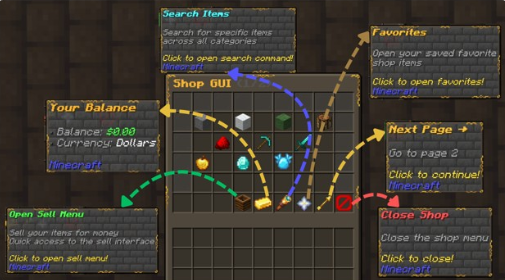
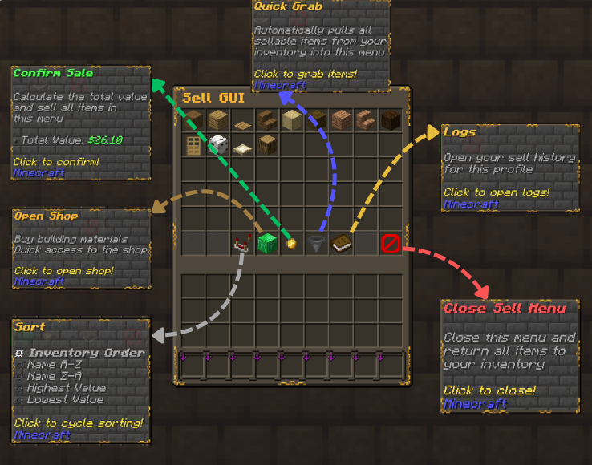
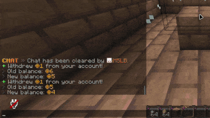
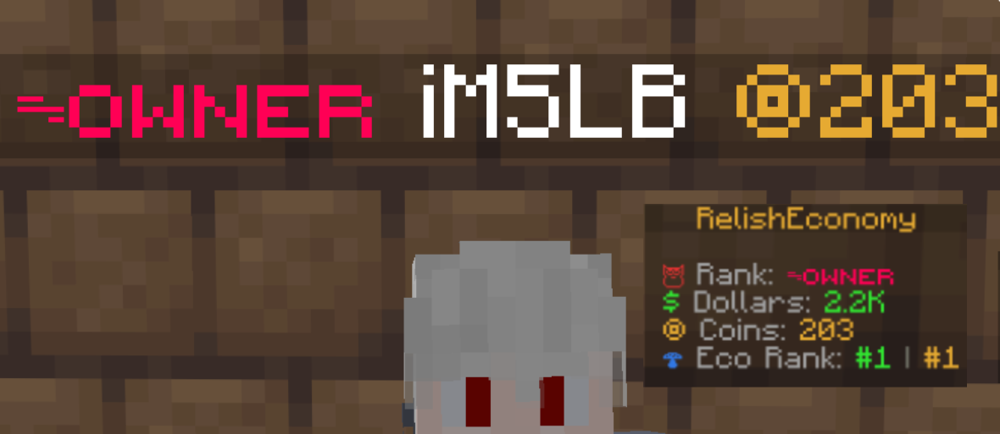

# RelishEconomy Documentation

## Quick Links

- [Installation](Installation.md)
- [Quick Start](QuickStart.md)
- [Configuration](Configuration.md)
- [Commands](Commands.md)
- [Shop System (Premium)](ShopSystem.md)
- [REST API](RestAPI.md)
- [PlaceholderAPI](PlaceholderAPI.md)
- [Permissions](Permissions.md)
- [Changelog](CHANGELOG.md)

## What's New (1.2.1-Beta)

- **Item price lore** — show sell/buy prices on item lore, with configurable update triggers (pickup, craft, inventory open, join).
- **Stale MySQL connection fix** — configurable `database.pool.max-lifetime` and `connection-test-query` prevent `Failed to validate connection` errors.
- **Configurable MySQL connection pool** — tune `maximum-pool-size`, `max-lifetime`, and proxy `connection-test-query` from `config.yml`.
- **Item price lore auto-strip** — when the lore feature is disabled, leftover lore is automatically removed from player inventories.

## Screenshots

